<div align="center">


<a href="https://github.com/Chiranjeeb-Dash-Git/GitSummarizer">
  
</a>

<br/>

[](https://gitsummarizer-puce.vercel.app/)
[](LICENSE)


<br/>

**[Live Demo](https://gitsummarizer-puce.vercel.app/)** &nbsp;·&nbsp; **[Architecture](#architecture)** &nbsp;·&nbsp; **[Quickstart](#quickstart)** &nbsp;·&nbsp; **[Configuration](#configuration)** &nbsp;·&nbsp; **[Deployment](#deployment)** &nbsp;·&nbsp; **[Report an Issue](https://github.com/Chiranjeeb-Dash-Git/GitSummarizer/issues)**

</div>


## Overview

**GitSummarizer** turns a public GitHub repository into a structured, beginner-friendly overview and release notes.

It collects the README, file tree, dependency manifests and recent commits through the GitHub REST API, sends that context to the AI provider you configure, and streams the result to the browser over Server-Sent Events. Finished summaries are stored in Neon PostgreSQL, keyed by a hash of the repository URL, so a repeat request is answered from the cache instead of calling GitHub and the model again.

<!--
PREVIEW: add a real screenshot or short GIF of the app, then uncomment the line below.
<p align="center"></p>
-->


## Features

<table>
  <tr>
    <td width="50%" valign="top">
      <h3>Live streaming</h3>
      Summaries appear token by token over Server-Sent Events, with no polling loop.
    </td>
    <td width="50%" valign="top">
      <h3>Provider-agnostic AI</h3>
      Switch between Gemini, OpenAI and Anthropic with one environment variable (<code>AI_PROVIDER</code>).
    </td>
  </tr>
  <tr>
    <td width="50%" valign="top">
      <h3>Deduplicated cache</h3>
      Results are stored in Neon PostgreSQL and looked up by repository URL hash.
    </td>
    <td width="50%" valign="top">
      <h3>Verified accounts</h3>
      Email verification through Resend. Verification codes are never returned in API responses.
    </td>
  </tr>
  <tr>
    <td width="50%" valign="top">
      <h3>Hardened API</h3>
      Origin guard, rate limiting and Zod request validation on the Express layer.
    </td>
    <td width="50%" valign="top">
      <h3>Animated interface</h3>
      Built with Framer Motion and Lenis smooth scrolling on React and Tailwind CSS v4.
    </td>
  </tr>
</table>


## Architecture



**Request lifecycle**

1. The client submits a public repository URL.
2. The API validates the request, then checks Neon for a cached summary. A hit returns the stored result.
3. On a miss, the API fetches the README, file tree, dependency manifests and commit history from GitHub.
4. It builds a prompt from that context and sends it to the selected AI provider.
5. Tokens stream back from the provider.
6. The API relays them to the client as Server-Sent Events and persists the finished summary.

### Engineering decisions

| Decision | Reason |
| :--- | :--- |
| Server-Sent Events for output | One-way token stream over plain HTTP. No polling, no extra protocol. |
| Neon serverless driver over WebSockets (`ws`) with the pooled connection string | Suited to serverless runtimes where long-lived TCP connections are impractical. |
| Cache keyed by repository URL hash | Avoids repeat GitHub and model calls for the same repository. |
| Provider interface behind `AI_PROVIDER` | Swap models without touching application code. |
| Verification codes kept server-side | Codes are never exposed in API responses. |

<!--
CHALLENGES AND FIXES: fill with real problems you hit, then remove the comment markers.

### Challenges and fixes

| Problem | Root cause | Fix |
| :--- | :--- | :--- |
| (symptom or error message) | (why it happened) | (what you changed) |
-->


## Tech stack

| Layer | Technology |
| :--- | :--- |
| Frontend | React 18, Vite 5, Tailwind CSS v4, Framer Motion, Lenis |
| State and data | Zustand, TanStack React Query |
| Backend | Node.js, Express 4, Zod |
| Database | Neon serverless PostgreSQL (`@neondatabase/serverless`) |
| AI providers | Google Gemini, OpenAI, Anthropic |
| Integrations | GitHub REST API, Resend (email) |
| Testing | Vitest, Node test runner |
| Hosting | Vercel |


## Quickstart

**Prerequisites:** Node.js 20.19+, 22.13+ or 24+ &nbsp;·&nbsp; npm 10+ &nbsp;·&nbsp; Git &nbsp;·&nbsp; a Neon database &nbsp;·&nbsp; one AI provider key &nbsp;·&nbsp; a Resend key

```bash
# 1. Clone
git clone https://github.com/Chiranjeeb-Dash-Git/GitSummarizer.git
cd GitSummarizer

# 2. Install (root, backend, frontend)
npm install
cd backend && npm install
cd ../frontend && npm install
cd ..

# 3. Configure environment (see Configuration below)

# 4. Create tables and indexes on your Neon database
cd backend && npm run migrate && cd ..

# 5. Run (two terminals)
npm run dev:api    # backend  -> http://localhost:8080
npm run dev:web    # frontend -> http://localhost:5173
```


## Configuration

**`backend/.env`**

```ini
# Server
PORT=8080
NODE_ENV=development
CLIENT_ORIGIN=http://localhost:5173

# Neon PostgreSQL (pooled connection string)
DATABASE_URL=postgresql://<user>:<password>@<pooler-host>.neon.tech/neondb?sslmode=require&channel_binding=require

# AI provider: gemini | openai | anthropic
AI_PROVIDER=gemini
GEMINI_API_KEY=
GEMINI_MODEL=gemini-flash-latest

# Optional providers
OPENAI_API_KEY=
OPENAI_MODEL=gpt-4o-mini
ANTHROPIC_API_KEY=
ANTHROPIC_MODEL=claude-3-5-sonnet-20241022

# Email verification
RESEND_API_KEY=
EMAIL_FROM=GitSummarizer <hello@your-verified-domain.example>

# Auth
JWT_SECRET=
```

**`frontend/.env`**

```ini
VITE_API_BASE_URL=http://localhost:8080/api/v1
```

> **Notes**
> - Generate a strong secret: `node -e "console.log(require('crypto').randomBytes(48).toString('hex'))"`
> - Registration requires successful email delivery. For local testing, point the Resend SDK at an emulator with `RESEND_BASE_URL` and use synthetic credentials.
> - Never commit `.env` files. Only commit placeholders.


## Deployment

The project deploys to **[Vercel](https://vercel.com)** as a monorepo: **[live deployment](https://gitsummarizer-puce.vercel.app/)**.

1. Push the repository to GitHub.
2. In Vercel, choose **Add New Project** and import the repository.
3. Add the environment variables below in the project settings.
4. Deploy. Vercel builds the client bundle and serves the API through serverless functions.

| Variable | Purpose |
| :--- | :--- |
| `DATABASE_URL` | Neon pooled connection string |
| `AI_PROVIDER`, `GEMINI_API_KEY`, `GEMINI_MODEL` | AI provider selection and credentials |
| `JWT_SECRET` | Token signing secret |
| `RESEND_API_KEY`, `EMAIL_FROM` | Registration emails (use a verified sender domain) |
| `CLIENT_ORIGIN` | Allowed origin for the API origin guard |
| `NODE_ENV` | `production` |


## Contributing

Issues and pull requests are welcome. Fork the repository, create a feature branch, and open a pull request describing the change. Bugs and feature requests go to [GitHub Issues](https://github.com/Chiranjeeb-Dash-Git/GitSummarizer/issues).

## License

Released under the **MIT License**. See [`LICENSE`](LICENSE).

<div align="center">


</div>
